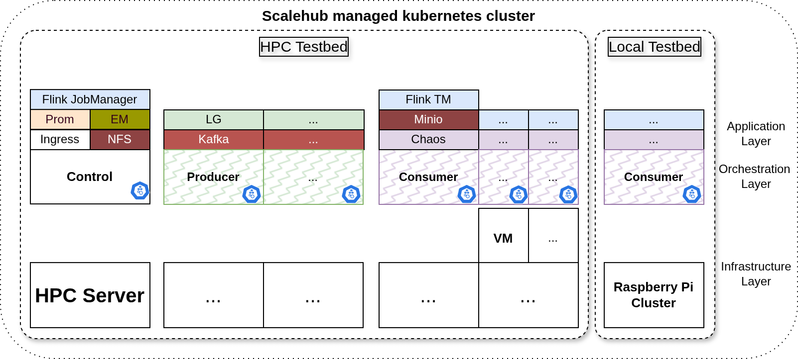

<p align="center">
  
</p>

ScaleHub builds short-lived Kubernetes (K3s) clusters that span very different hardware (bare-metal servers, VMs
and Raspberry Pi boards) and runs reproducible stream processing experiments on them.

I built it during my PhD at Inria / IRISA (Univ Rennes) to study how Apache Flink scales when compute power and
network latency differ from node to node. It provisions nodes on [Grid'5000](https://www.grid5000.fr) and local
clusters, joins them into one network, deploys the full experiment stack with Ansible, scales Flink step by step and
exports the metrics and plots at the end.

> **Status:** research code from 2023–2025, no longer maintained. Running it needs a Grid'5000 account (or your own
> cluster through a custom provider). The papers below were produced with it.

## What it does

- **Provisioning across testbeds**: Grid'5000 bare-metal and VMs through [EnOSlib](https://discovery.gitlabpages.inria.fr/enoslib/),
  plus a Raspberry Pi cluster, described together in one INI file. A Tailscale mesh connects nodes that sit on
  different networks.
- **Cluster orchestration**: K3s on every node. Nodes are labelled by role (`control`, `producer`, `consumer`) and by
  hardware type, so each workload lands on the right machines.
- **Application stack**: Flink, Kafka, MinIO, NFS, Prometheus / VictoriaMetrics / Grafana, Chaos Mesh, ingress and
  load generators. Each one is an Ansible role you can deploy, delete or reload on its own.
- **Experiment runner**: an in-cluster service controlled over MQTT. A state machine (IDLE → STARTING → RUNNING →
  FINISHING) runs each experiment: savepoint, stop, rescale the TaskManager StatefulSets, restore, repeat. Static
  scaling patterns (linear, exponential, block) and the TransScale autoscaler are both supported.
- **Network emulation**: Chaos Mesh adds latency, jitter or bandwidth limits to a chosen share of nodes.
- **Data pipeline**: metrics are pulled from VictoriaMetrics, aggregated over runs and exported as CSV and plots.



## Quick start

Everything runs from a Docker container that comes with Ansible, EnOSlib and the `shub` CLI.

```shell
./deploy.sh generate     # Grid'5000 credentials as a Docker secret
./deploy.sh create       # build and start the scalehub, vpn and dns containers
./deploy.sh shell        # open a shell inside the scalehub container

shub -c conf/provision/rennes_small.ini provision   # reserve nodes and run the infrastructure playbook
shub deploy orchestration/setup                     # install K3s and label the nodes
shub deploy application/setup                       # deploy the experiment stack
shub -c conf/experiment/single_node/single_node_bm.ini experiment start
shub destroy                                        # release the reservation
```

See [docs/getting-started.md](docs/getting-started.md) for prerequisites (VPN files, SSH keys, local DNS).

## Documentation

| Document                                         | Content                                                    |
|--------------------------------------------------|------------------------------------------------------------|
| [Getting started](docs/getting-started.md)       | Prerequisites, secrets, the `deploy.sh` helper, local DNS  |
| [Usage](docs/usage.md)                           | `shub` commands, playbook order, dashboards, data export   |
| [Configuration](docs/configuration.md)           | Provisioning files, experiment files, scaling strategies   |
| [Architecture](docs/architecture.md)             | Layers, node roles, experiment monitor, rescaling workflow |
| [Playbooks](docs/playbooks.md)                   | What each Ansible playbook and role deploys                |
| [Extending](docs/extending.md)                   | Adding a platform provider, a playbook or experiment type  |
| [Data module](src/scalehub/data/README.md)       | Loading, processing, exporting and plotting strategies     |

## Repository layout

```
conf/         provisioning and experiment configurations (INI) and scaling strategies (YAML)
playbooks/    Ansible playbooks: infrastructure, orchestration, application
setup/        Dockerfiles and compose file for the scalehub container, monitor image, nginx, DNS
src/shub      CLI entry point
src/scalehub/ platforms, Kubernetes/Flink helpers, data processing and plotting
src/monitor/  in-cluster experiment monitor (MQTT + state machine)
test/         pytest suite
```

## Publications

ScaleHub was used to run the experiments in:

- K. Arsalane, G. Pierre, S. Ibrahim. **Toward Stream Processing Elasticity in Realistic Geo-Distributed
  Environments.** IEEE International Conference on Cloud Engineering (IC2E), 2024, pp. 118–125.
  [doi:10.1109/IC2E61754.2024.00020](https://doi.org/10.1109/IC2E61754.2024.00020)
- K. Arsalane, G. Pierre. **Data Stream Processing Effectiveness in Heterogeneous Computing Environments.**
  ACM/SIGAPP Symposium on Applied Computing (SAC), 2026, pp. 274–281.
  [doi:10.1145/3748522.3779774](https://doi.org/10.1145/3748522.3779774)
- K. Arsalane. **Scalable Data Stream Processing in Heterogeneous Environments.** PhD thesis, Université de Rennes,
  2025. ScaleHub is described in Chapter 6. [theses.fr/2025URENS105](https://theses.fr/2025URENS105)

<details>
<summary>BibTeX</summary>

```bibtex
@inproceedings{arsalane2024toward,
  author    = {Arsalane, Khaled and Pierre, Guillaume and Ibrahim, Shadi},
  title     = {Toward Stream Processing Elasticity in Realistic Geo-Distributed Environments},
  booktitle = {2024 IEEE International Conference on Cloud Engineering (IC2E)},
  pages     = {118--125},
  year      = {2024},
  doi       = {10.1109/IC2E61754.2024.00020}
}

@inproceedings{arsalane2026dsp,
  author    = {Arsalane, Khaled and Pierre, Guillaume},
  title     = {Data Stream Processing Effectiveness in Heterogeneous Computing Environments},
  booktitle = {Proceedings of the 41st ACM/SIGAPP Symposium on Applied Computing (SAC '26)},
  pages     = {274--281},
  year      = {2026},
  doi       = {10.1145/3748522.3779774}
}

@phdthesis{arsalane2025thesis,
  author = {Arsalane, Khaled},
  title  = {Scalable Data Stream Processing in Heterogeneous Environments},
  school = {Universit{\'e} de Rennes},
  year   = {2025},
  note   = {NNT: 2025URENS105}
}
```

</details>

## Acknowledgements

Experiments were carried out on the Grid'5000 testbed, supported by a scientific interest group hosted by Inria and
including CNRS, RENATER and several universities as well as other organizations (see https://www.grid5000.fr).

## License

[AGPL-3.0-or-later](LICENSE).
