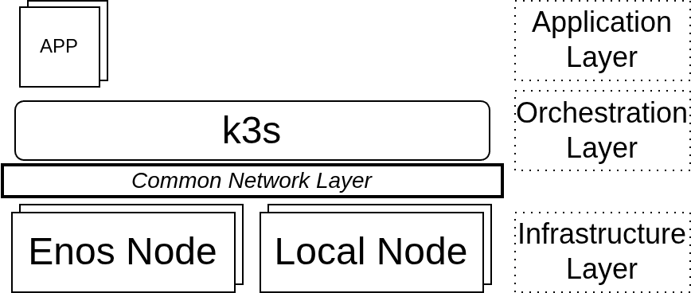
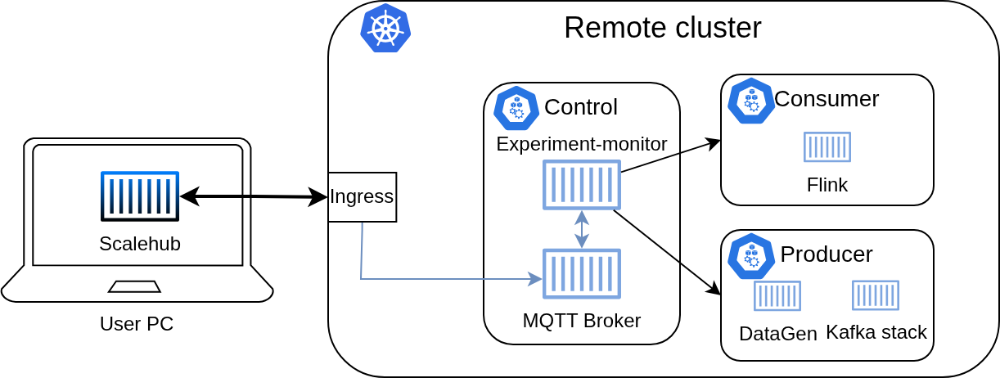
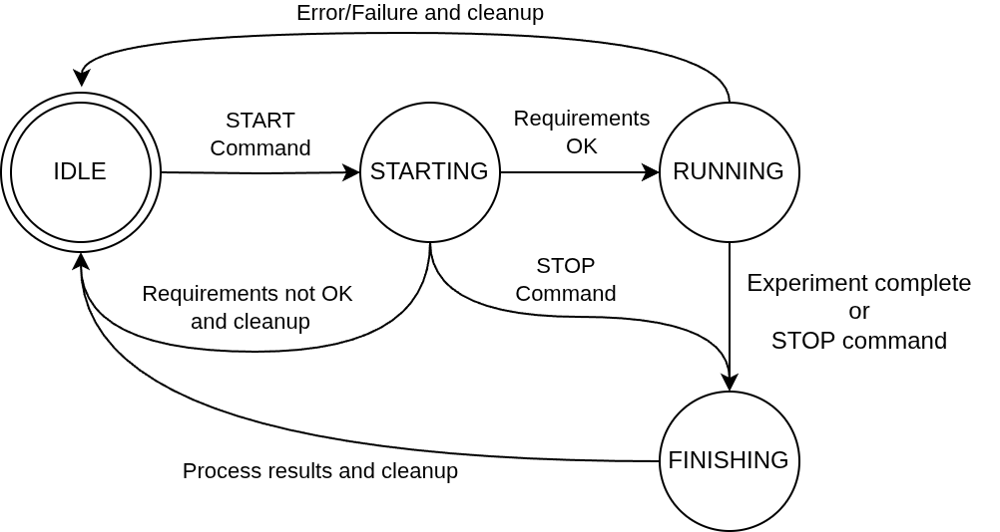

# Architecture

ScaleHub has to solve three problems to run the same stream processing experiment across very different machines:

- **Heterogeneous hardware.** Nodes range from ARM boards with a few GB of RAM to 32-core x86 servers. Vanilla
  Kubernetes scheduling assumes interchangeable nodes, so ScaleHub controls placement explicitly.
- **Connectivity between testbeds.** Grid'5000's VPN is meant for users, not for node-to-node traffic, and a local
  cluster usually sits behind a NAT or a corporate firewall. Every node has to see every other node.
- **Reproducibility.** An experiment campaign means provisioning, deploying, running, collecting and tearing down many
  times. Each of those steps has to be scripted and give the same result every time.

It handles them with three layers, all driven by Ansible from the `scalehub` container.



## Infrastructure layer

`shub provision` reads the provisioning file and creates one `Platform` object per entry
(`src/scalehub/platforms/`). EnOSlib-backed platforms (Grid'5000 bare metal, VMs on Grid'5000, FIT) reserve nodes
through the testbed API. The `RaspberryPi` platform reads a static inventory and checks each host over SSH. The
resulting hosts are merged into one Ansible inventory with groups per role (`control`, `agents`) and per platform.

`playbooks/infrastructure/setup.yaml` then prepares every node: base packages, data folders, IPv6 on Grid'5000
nodes and VMs, and the Tailscale client. The orchestration step uses Tailscale to give every node a flat, routable
network whichever testbed it comes from. Between the Grid'5000 and local nodes we measured a stable delay of about
20 ms.

## Orchestration layer

`playbooks/orchestration/setup.yaml` installs K3s (pinned with `k3s_version`) on control and worker nodes. K3s
keeps the Kubernetes API while needing far fewer resources, so it also runs on Raspberry Pi boards. When
`tailscale_backend` is on, nodes join the mesh through K3s's built-in Tailscale integration (`--vpn-auth`), and the
cluster network runs over it.

After installation, the `post_install` role labels each node:

| Label                                   | Values                                        | Used for                               |
|-----------------------------------------|-----------------------------------------------|----------------------------------------|
| `node-role.kubernetes.io/worker`        | `producer`, `consumer`                        | separate load generation from the system under test |
| `node-role.kubernetes.io/tnode`         | `grid5000`, `vm_grid5000`, `pico`             | choose the hardware kind in a scaling step |
| `node-role.kubernetes.io/node-size`     | `small`, `medium`, `large`, `x-large`         | size class from allocatable CPU × memory |
| `node-role.kubernetes.io/scaling`, `…/state` | `SCHEDULABLE`, `FULL`                    | set at runtime by the experiment monitor |

Every deployment uses node selectors and affinities on these labels. Kafka and the load generators stay on producer
nodes, Flink TaskManagers on consumer nodes, and shared services on the control node. Load generation therefore never
competes with the system under test for CPU.

## Application layer


Each component is an Ansible role in `playbooks/application/roles/` with `create` and `delete` tags, so it can be
deployed, removed or reloaded on its own (see [Playbooks](playbooks.md)):

- **Flink**: JobManager on the control node. TaskManagers are StatefulSets, one per size template (`s`, `m`, `l`,
  `xl`, `xxl`, `pico`), each starting at 0 replicas.
- **Kafka**: Zookeeper, Kafka brokers, Schema Registry and Redis, plus the Theodolite load generators, all on
  producer nodes.
- **Storage**: MinIO for Flink checkpoints and savepoints, plus an NFS storage class (csi-driver-nfs) backed by the
  Grid'5000 site NFS server.
- **Monitoring**: Prometheus and Grafana for live dashboards, VictoriaMetrics for long-term metrics read by the data
  pipeline, Consul for latency estimates, and the Kubernetes dashboard.
- **Network**: ingress-nginx and cert-manager, exposed on the workstation through the local reverse proxy and DNS.
- **Chaos**: Chaos Mesh, used to add delay, jitter or bandwidth limits to a share of consumer nodes.
- **TransScale**: an external autoscaler that picks Flink parallelism from load and network measurements.

## Experiment monitor



The experiment monitor (`src/monitor/`, image built by `.github/workflows/monitor.yaml`) runs on the control node and
manages experiments from inside the cluster. `shub experiment start` sends the serialized configuration over MQTT and
returns. The monitor then works alone, so long or overnight campaigns don't depend on the workstation staying online.



The monitor has two threads: one listens on MQTT for `START`, `STOP` and `CLEAN`, the other runs a state machine:

- **IDLE**: waits for a `START`. One experiment runs at a time. Configurations sent together are queued and run in
  order.
- **STARTING**: takes the next configuration, builds the matching experiment type and prepares the cluster. On
  failure it cleans up and returns to IDLE.
- **RUNNING**: runs the experiment type (`simple`, `transscale`, `resource`) for the configured number of runs.
  Errors lead to cleanup and IDLE.
- **FINISHING**: on completion or `STOP`, pulls metrics for each run's time window from VictoriaMetrics, writes CSV
  files and plots, then returns to IDLE.

### Rescaling workflow

Each step of a scaling strategy changes Flink's parallelism without losing operator state:

1. Trigger a savepoint, stored in MinIO.
2. Stop the job through the Flink CLI so in-flight records are drained.
3. Mark the next free node of the requested kind as `SCHEDULABLE`, then scale the matching TaskManager StatefulSet
   through the Kubernetes API.
4. Wait for the new TaskManagers to register, then resubmit the job from the savepoint with the new parallelism.
5. Check that the job is `RUNNING`, wait `interval_scaling_s`, and go on to the next step.

The scaling patterns are `linear` (+1), `exponential` (+1, +2, +4, …) and `block` (+n at once). With
`type = transscale`, the scaling decisions come from TransScale instead of a fixed schedule.

## Code map

```
src/
├── shub                         CLI entry point (argparse)
├── scalehub/
│   ├── platforms/               Platform base class, EnOSlib and Raspberry Pi providers, factory, ProvisionManager
│   ├── resources/               Kubernetes and Flink helpers (nodes, StatefulSets, pods, savepoints)
│   ├── data/                    loading, processing, exporting and plotting strategies
│   └── Client.py                MQTT client used by `shub experiment`
├── monitor/
│   ├── monitor.py               MQTT listener
│   └── experiments/             state machine, Scaling, experiment types
└── utils/                       Config, defaults, logging, Ansible runner wrapper
```
