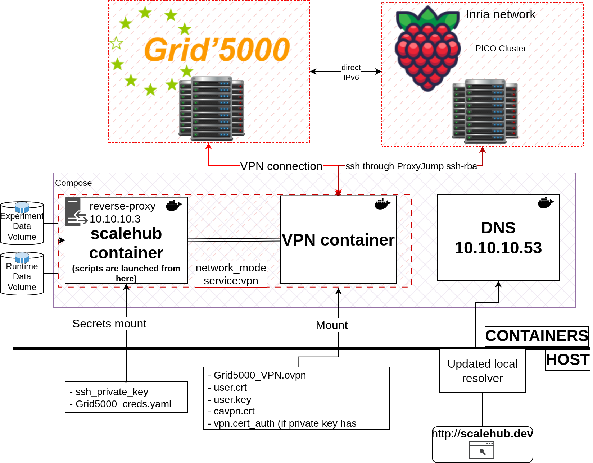

# Getting started

ScaleHub runs from a Docker container on your workstation. That container shares the network of an OpenVPN client
container to reach the Grid'5000 nodes, and it drives them with Ansible. A third container serves a small DNS zone, so
you can open the cluster's web interfaces from your browser.



## Prerequisites

- Docker with the compose plugin.
- A [Grid'5000](https://www.grid5000.fr) account, along with:
  - your personal VPN files (`.ovpn`, `.key`, `.crt`), see the [Grid'5000 VPN guide](https://www.grid5000.fr/w/VPN);
  - an SSH key pair registered on Grid'5000, see the [Grid'5000 SSH guide](https://www.grid5000.fr/w/SSH#Generating_keys_for_use_with_Grid'5000).
- Optional: a Raspberry Pi cluster reachable over SSH, described by an Ansible inventory file (see
  [Configuration](configuration.md#raspberry-pi-cluster)).

## Secrets

Everything secret lives in `setup/scalehub/secrets/`, which is git-ignored:

```
setup/scalehub/secrets/
├── enos/
│   ├── Grid5000_creds.yaml   # created by ./deploy.sh generate
│   ├── grid5000.pk           # SSH private key for Grid'5000
│   └── grid5000.pub          # SSH public key
└── vpn/                      # extracted Grid'5000 VPN files
```

`Grid5000_creds.yaml` has this format:

```yaml
username: <grid5000_username>
password: <grid5000_password>
```

Compose mounts these files as Docker secrets. Inside the container they show up as `~/.python-grid5000.yaml`
(read by EnOSlib) and `~/.ssh/id_rsa`. The compose file also forwards your host's `SSH_AUTH_SOCK`, so keys loaded in
your SSH agent are available too.

`./deploy.sh create` also generates `setup/scalehub/secrets/scalehub{,.pub}`. The public key is added to the
container's `authorized_keys`, so an IDE can open a remote session in the container.

## The `deploy.sh` helper

```
./deploy.sh <option>

  build                     Build the images without starting the containers
  generate                  Write Grid'5000 credentials to setup/scalehub/secrets/enos/Grid5000_creds.yaml
  create                    Build the image and start the scalehub, vpn and dns containers
  remove                    Stop and remove the containers
  restart                   Restart all containers
  restart_ss <service>      Restart a single service
  shell                     Open an interactive shell in the scalehub container
  push <registry>           Push the scalehub image to a registry
  help                      Show this help
```

A first run looks like this:

```shell
git clone https://github.com/ark-sys/scalehub.git && cd scalehub
./deploy.sh generate
# copy the VPN files to setup/scalehub/secrets/vpn/ and the SSH keys to setup/scalehub/secrets/enos/
./deploy.sh create
./deploy.sh shell
```

From the shell you get inside the container, `shub --help` should print the CLI usage. The `src/`, `conf/` and
`playbooks/` folders are copied into the image at `/app`. After editing them on the host, rebuild with
`./deploy.sh restart_ss scalehub`. Experiment results go to the `experiments_data` volume, mounted at
`/app/experiments-data`.

## Local DNS and dashboards

The scalehub container runs nginx as a reverse proxy. It shares the VPN container's address (`10.10.10.3`), and the
`dns` container (`10.10.10.53`) resolves `*.scalehub.dev` to that address.
To use these names from your host, put that DNS server first. With systemd-resolved:

```ini
# /etc/systemd/resolved.conf
[Resolve]
DNS=10.10.10.53
FallbackDNS=1.1.1.1 8.8.8.8
```

```shell
sudo systemctl restart systemd-resolved
resolvectl status   # 10.10.10.53 should be listed first
```

Once the application stack is deployed, the landing page is at <http://scalehub.dev/>. It links to Grafana,
Prometheus, VictoriaMetrics, the Flink UI, MinIO, Chaos Mesh, Consul and the Kubernetes dashboard. `shub tokens`
prints the Kubernetes dashboard login token.

Next: [Usage](usage.md).

## Running the tests

The unit tests mock Kubernetes, Flink, Ansible and EnOSlib, so they run without a cluster:

```shell
pip install -r setup/scalehub/requirements.txt pytest-mock
PYTHONPATH=.:src pytest test
```
